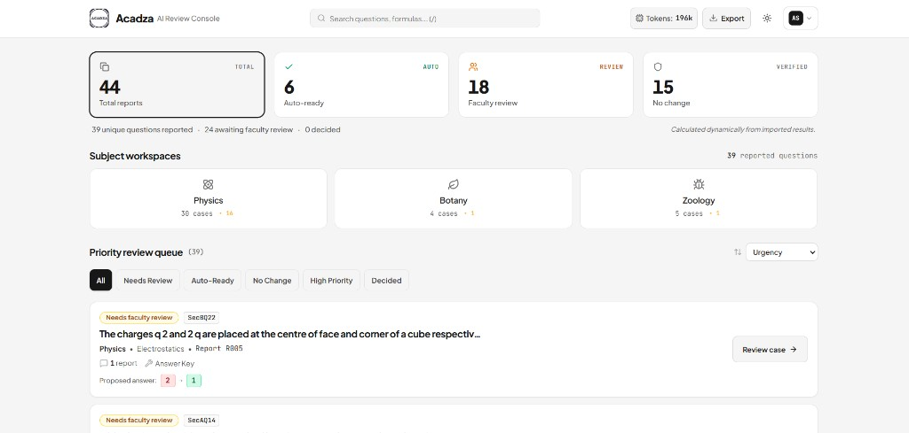

# Acadza Report → Fix

Intent-first triage engine + faculty review console for student “Report error” tickets on JEE/NEET questions.

The **next student** loses when a key stays wrong. This system treats each report as a *lead*, not an instruction: classify what the student is asking, spend tokens only when needed, then propose a surgical fix with a short teacher-voice reply.

---

## Faculty console



Queue grouped by question, ordered by blast radius (sibling reports + academic risk). Faculty see MathML-rendered stems, AI finding, before/after edit, and an editable student reply.

> **Deploy note:** the live demo loads **precomputed** `results.json` / `cases.json` (no LLM credits required at runtime).  
> **R005 (Gauss / flux):** committed result is **`2 → 1`** (`faculty_review`). If a cached browser still shows `2 → 5`, hard-refresh or use **Reset to engine results**.

| Deliverable | Location |
|---|---|
| Engine results | [`output/results.json`](output/results.json) |
| Faculty console | [`acadza-—-ai-review-console/`](acadza-—-ai-review-console/) |
| Product thinking | [`PRODUCT.md`](PRODUCT.md) |
| Prompts + decisions | [`PROMPTS.md`](PROMPTS.md) |
| Bonus unreported defects | [`output/bonus_unreported_defects.md`](output/bonus_unreported_defects.md) |

---

## Solution (how it works)

### 1. Intent first — then spend tokens

```
report comment
    → rules + gpt-4o-mini (report text only)
    → spend tier L0 | L1 | L2
    → strong solve ONLY if some sibling is L2
    → taxonomy_guard (code)
    → student reply (mini / teacher template)
```

| Tier | Student is asking about… | What we spend |
|---|---|---|
| **L0** | Spelling, chapter, NEET tag, markup, app | Rules / mini · **never solve** |
| **L1** | Unit / form (e.g. 0.08 m vs key **8** cm) | Stored solution · **no gpt-4o solve** |
| **L2** | Answer key or solution steps wrong | **One** gpt-4o solve per question (cached) |

Chapter rage (“displacement current ≠ geometrical optics”) never flips a key. Unit confusion never replaces `8` with `0.08`.

### 2. Solve once, decide many

Sibling reports on the same `questionId` share one solve + solution reading. Each report still gets its own verdict, evidence, and student reply.

### 3. Taxonomy guard owns the write

LLM proposes; code decides. Guards block:

- edits outside the repair’s allowed fields  
- non-surgical / markup-breaking finds  
- student-led flips when solution already matches the key  
- unit-scale key flips (`8` ↔ `0.08`)  
- solver finals that disagree with **stored solution + student claim** (Gauss trap → prefer **n = 1**, not a hallucinated `5`)

### 4. Two audiences, two voices

| Surface | Voice |
|---|---|
| **AI Finding** (faculty) | Plain English for a teacher at 10 PM — no `Intent=` / pipeline jargon |
| **Student reply** | Class-teacher tone (“you / your”), 1–3 lines — never “The student claims…” |

### 5. What never auto-applies

Identical options, diagrams, wrong chapter/syllabus, unsound questions, and answer-key changes without independent confirmation → **`faculty_review`**. Low-risk spelling / exam-tag cleanups can **`auto_apply`**.

---

## Run locally

### Triage engine

```bash
cp .env.example .env   # OpenRouter key + models
pip install -r requirements.txt
python -m engine.main run --workers 2 --no-cache
```

Writes `output/results.json`, `cases.json`, `usage.json`. Sync into the console with:

```bash
python scripts/rerun_full.py --workers 2
```

Models (`.env`): main/solver `openai/gpt-4o`, fast `openai/gpt-4o-mini`.

### Faculty console (what Vercel deploys)

```bash
cd acadza-—-ai-review-console
npm install
npm run dev
```

Open [http://localhost:3000](http://localhost:3000). The app reads bundled `src/data/real/{results,cases,usage,questions,reports,taxonomy}.json`.

---

## Data

| File | What it is |
|---|---|
| `data/questions.json` | 43 production-format questions (HTML + MathML) |
| `data/reports.json` | 44 student reports (siblings share `questionId`) |
| `data/taxonomy.json` | Closed verdicts / repairs + `auto` flags |

---

## Repo layout

```
engine/                         # intent → solve → guard → reply
  routing.py                    # L0 / L1 / L2 spend tiers
  fast_path.py                  # deterministic L0 proposals
  unit_form_path.py             # 0.08 ↔ 8 without re-solve
  taxonomy_guard.py             # final safety / route
  prompts/                      # product prompts (also in PROMPTS.md)
acadza-—-ai-review-console/     # Vite + React faculty UI
output/results.json             # scored deliverable (44 rows)
docs/console-queue.png          # console screenshot
PRODUCT.md · PROMPTS.md
```

---

## Assignment checklist

1. Public GitHub repo + `results.json`  
2. Live faculty console URL (precomputed results OK if noted)  
3. `PROMPTS.md` · `PRODUCT.md`  
4. ~3 min walkthrough video  

Original brief scoring weights: triage accuracy 25 · safety 10 · console UX 20 · product 20 · prompts 15 · engineering 10.

*Built for the Acadza AI Intern “Report → Fix” assignment.*
